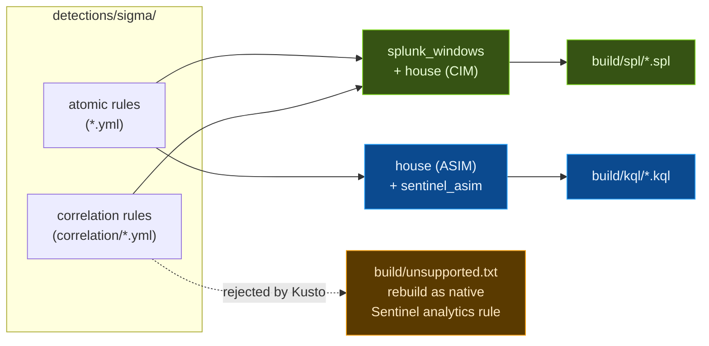

<div align="center">



<p>
  <a href="https://github.com/logsexe/artex-detection-as-code/actions/workflows/detection-as-code.yml">
    
  </a>
  
  
  
  
</p>

<strong>Compile one Sigma rule tree into SIEM-ready detections for both Splunk and Microsoft Sentinel — pipelines as code, reproducible in CI.</strong>

<sub>
  <a href="#why">Why</a> &nbsp;&#183;&nbsp;
  <a href="#how-it-works">How it works</a> &nbsp;&#183;&nbsp;
  <a href="#quick-start">Quick start</a> &nbsp;&#183;&nbsp;
  <a href="#pipeline-chains">Pipelines</a> &nbsp;&#183;&nbsp;
  <a href="#correlation-routing">Correlation routing</a> &nbsp;&#183;&nbsp;
  <a href="#ci">CI</a> &nbsp;&#183;&nbsp;
  <a href="#layout">Layout</a> &nbsp;&#183;&nbsp;
  <a href="#license">License</a>
</sub>

</div>

---

## Why

`sigma convert` emits correct *syntax* but *generic* field names — not something
you can paste into a SIEM. This repo pairs every target with a **pySigma
processing-pipeline chain** (one community base + one thin house layer) so each
query comes out mapped to the real schema — **Splunk CIM** and **Sentinel ASIM** —
version-controlled and promoted through CI, in both query languages from a single
source of truth.

| | Splunk | Microsoft Sentinel |
|---|---|---|
| Language | SPL | KQL (Kusto) |
| Schema | CIM | ASIM |
| Backend | `pySigma-backend-splunk` | `pySigma-backend-kusto` |
| Community base | `splunk_windows` | `sentinel_asim` |
| House layer | `pipelines/splunk_artex_house.yml` | `pipelines/sentinel_asim_artex_house.yml` |

## How it works



One Sigma detection compiles to **both** targets. A Sigma **correlation** rule
compiles on Splunk but Kusto rejects it — those are *routed*, never dropped (see
[Correlation routing](#correlation-routing)).

## Quick start

> Only host dependency is **Docker**. The pinned sigma-cli toolchain runs in a
> container, so builds are byte-for-byte reproducible.

```bash
cd detection-as-code
make build     # -> build/spl/*.spl, build/kql/*.kql, build/unsupported.txt
make demo      # one rule, SPL + KQL side by side (DEMO_RULE=<name> to pick)
```

<details>
<summary><strong>Example — <code>make demo</code> output (field mapping applied)</strong></summary>

```spl
# Splunk SPL  (splunk_windows + house CIM)   —  artex_enrich_user_agent
sourcetype="artex:web" http_user_agent="artex-enrich/1.0"
```
```kql
// Sentinel KQL  (house ASIM + sentinel_asim) —  artex_enrich_user_agent
imWebSession
| where HttpUserAgent =~ "artex-enrich/1.0"
```
Raw Sigma `cs-user-agent` becomes CIM `http_user_agent` on Splunk and ASIM
`HttpUserAgent` on Sentinel — that is the house pipeline doing its job.
</details>

## Pipeline chains

One community/base pipeline + one thin house pipeline per target, layered by
priority (never fork the community pipeline):

- **Splunk** — `splunk_windows` (pri 20) → `splunk_artex_house.yml` (pri 30).
  House maps leftover generic fields to CIM (`cs-user-agent`/`c-useragent` →
  `http_user_agent`, `TargetFilename` → `file_path`, `CommandLine` → `process`)
  and scopes web/proxy logsources to a sourcetype. For `tstats` against a CIM
  data model, add `-f data_model`.
- **Sentinel** — `sentinel_asim_artex_house.yml` (pri 5) → `sentinel_asim`
  (pri 10). House runs *first* to normalise `cs-user-agent` → `HttpUserAgent`
  (so ASIM's own field validation accepts the rule) and pins a `query_table`
  for the keyword-only application rule.

Versions are pinned in `detection-as-code/requirements.lock` to match ARTEX's own
test suites: sigma-cli `3.1.0`, pySigma `1.5.1`, backends splunk `2.1.0` /
kusto `1.0.1` / elasticsearch `2.1.1` / loki `0.15.1`.

## Correlation routing

Asserted by ARTEX's own tests, so it is expected — not a bug:

```
Backend does not support correlation rules.
```

A single Sigma detection converts to both Splunk **and** Kusto. A Sigma
**correlation** rule converts on Splunk/EQL/Loki but the Kusto (and Lucene)
backends reject it. `build.sh` therefore feeds Kusto the atomic rules only and
writes every correlation rule to `build/unsupported.txt` with a reason, so an
engineer **rebuilds it natively** as a Sentinel scheduled/NRT KQL analytics rule.
Nothing is silently dropped.

## CI

`.github/workflows/detection-as-code.yml` runs on every push / PR:

- **`build`** — compiles the whole tree to SPL + KQL, enforces sanity gates
  (every atomic rule converts to both targets; every correlation rule appears in
  SPL **and** in `unsupported.txt`), and uploads the compiled detections artifact.
- **`sigma-suites`** — runs ARTEX's own pinned Sigma suites from
  `detections/tests/`: `sigma`, `sigma_lint`, `sigma_match`, `sigma_backends`.

## Layout

```
detection-as-code/      build tooling + house pipelines
  Dockerfile            pinned sigma-cli toolchain
  requirements.lock     exact sigma-cli + pySigma + 4 backend versions
  build.sh              the build (short bash loop over `sigma convert`)
  Makefile              make image | build | demo | clean
  pipelines/            house pipelines (code, version-controlled)
detections/
  sigma/                Sigma SOURCE rules (atomic *.yml + correlation/)
  tests/                ARTEX's own Sigma suites, run in CI
assets/hero.svg         animated banner
LICENSE  NOTICE         AGPL-3.0 + ARTEX attribution
```

## License

**AGPL-3.0.** The `detections/` content is derived from the ARTEX project
([Autumn-27/ARTEX](https://github.com/Autumn-27/ARTEX) via the
[jiwoochris/artex-global](https://github.com/jiwoochris/artex-global) fork). The
`detection-as-code/` tooling and `pipelines/` are original work added under the
same license. See [`NOTICE`](NOTICE) for the attribution and modification record.
